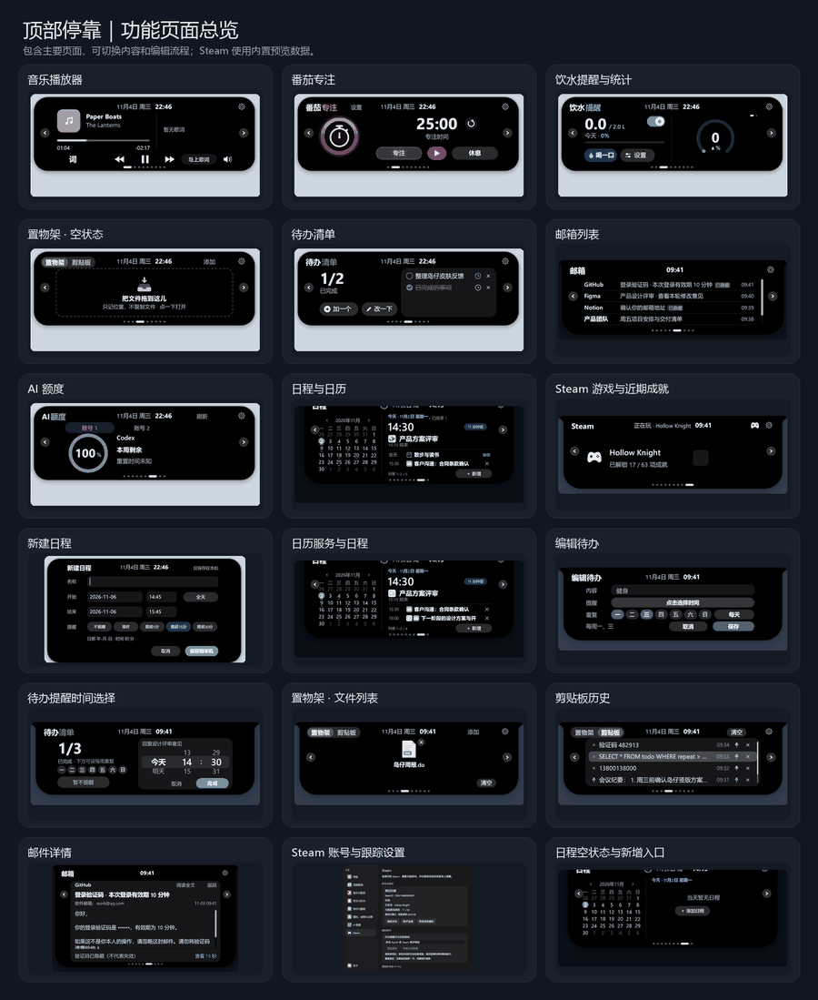
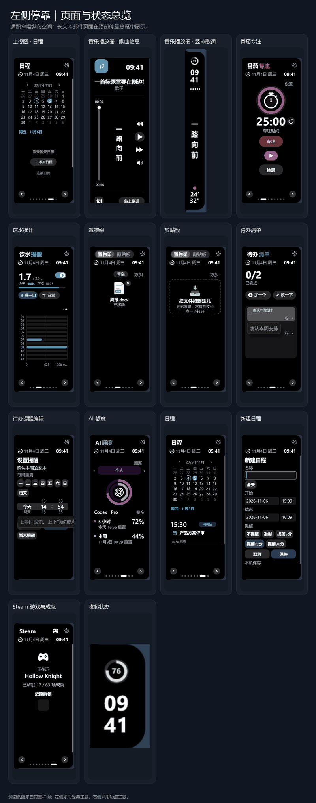
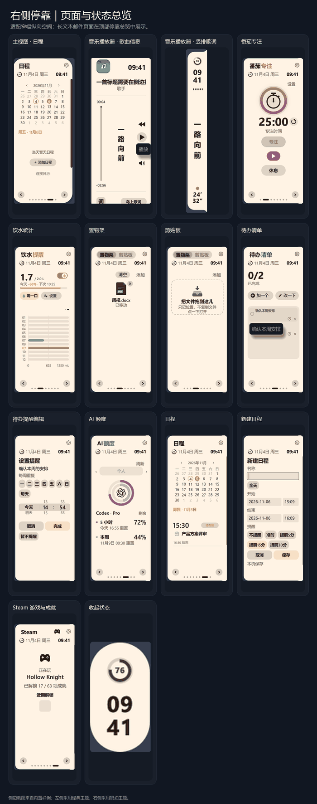
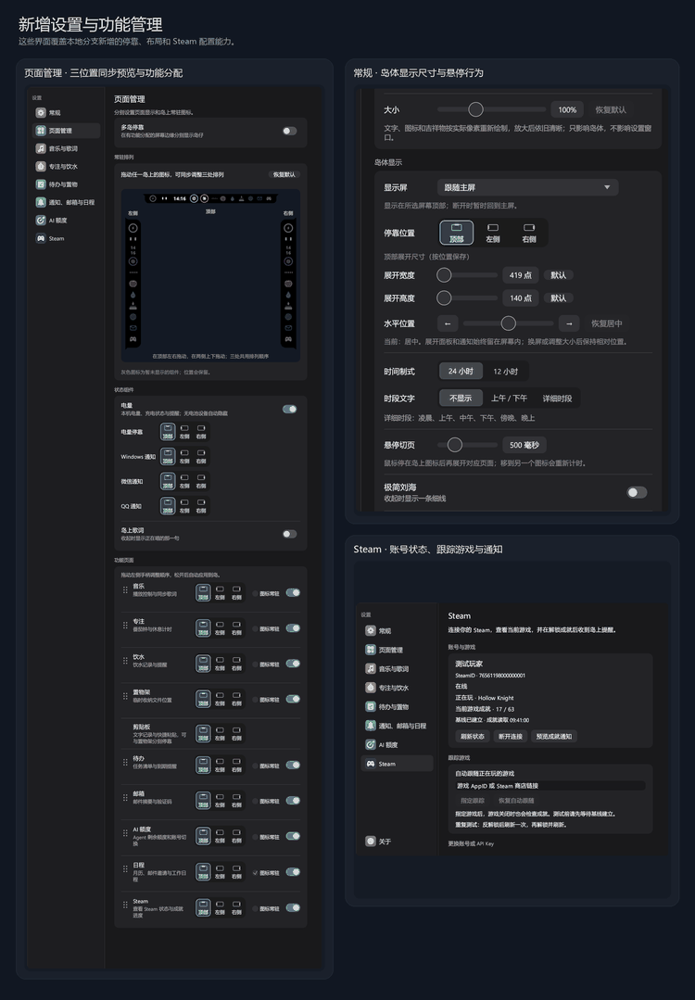

# 岛仔共创版 v0.6.62：Steam 成就上岛，三边灵动岛

把正在玩的游戏、刚解锁的成就和日常信息，放进一个轻巧的桌面信息岛里。

## 项目来源

岛仔（Daozai）是 Renly1994 开源的 Windows 桌面信息岛项目，原版已经集成音乐、日程、待办、饮水提醒等功能。我从这个项目继续共创开发，整理出这一版 Steam 与多位置停靠改进。它是个人 fork 的共创版本，基于上游 v0.6.62，不代表上游作者的官方发布。

上游项目：[Renly1994/xiaotang-daozai](https://github.com/Renly1994/xiaotang-daozai)

## Steam 游戏和成就

绑定 Steam 后，岛上可以显示当前游戏、游戏图标和成就进度。Steam 本地成就缓存更新后，岛仔会识别新的解锁记录，并在通知里显示成就图标、名称和描述。

成就通知依赖 Steam 将数据写入本地缓存；如果 Steam 延迟写盘，通知也会相应延后。Steam API Key 留在本机 Windows 凭据管理器中，截图里的账号和游戏信息均为演示数据。

## 顶部、左侧、右侧可以分开放

现在可以把不同功能分配到顶部、左侧和右侧三个位置，让三个灵动岛同时工作；同一个功能只分配到一个位置。页面管理可以分别调整图标常驻状态和停靠位置，预览区会同步展示三个位置的布局，也可以调整灵动岛尺寸和鼠标悬停打开页面的等待时间。

## 窄侧栏也有合适布局

左右侧停靠时，音乐、番茄专注、饮水、待办、Steam 等页面会按窄竖栏重新编排。音乐歌词纵向显示，游戏和歌曲长标题有空间时会滚动展示，常用控件也做了对应调整。顶部停靠保留原有横向布局。

## 界面实图

### 顶部停靠：主界面与可切换功能页

### 左侧停靠：纵向页面布局

### 右侧停靠：纵向页面布局

### 三位置预览、页面管理、尺寸设置与 Steam

## 下载体验

- [Windows 安装程序](https://github.com/dxydjl0521-maker/xiaotang-daozai-steam/releases/download/v0.6.62/Daozai-Setup-v0.6.62-x64.exe)
- [Windows x64 免安装 ZIP](https://github.com/dxydjl0521-maker/xiaotang-daozai-steam/releases/download/v0.6.62/Daozai-v0.6.62-windows-x64.zip)
- [v0.6.62 发布页与完整说明](https://github.com/dxydjl0521-maker/xiaotang-daozai-steam/releases/tag/v0.6.62)

安装后在设置的 Steam 页面填入 Steam Web API Key，再选择本机 Steam 登录或浏览器登录。欢迎试用，也欢迎在仓库里反馈问题和布局建议。
